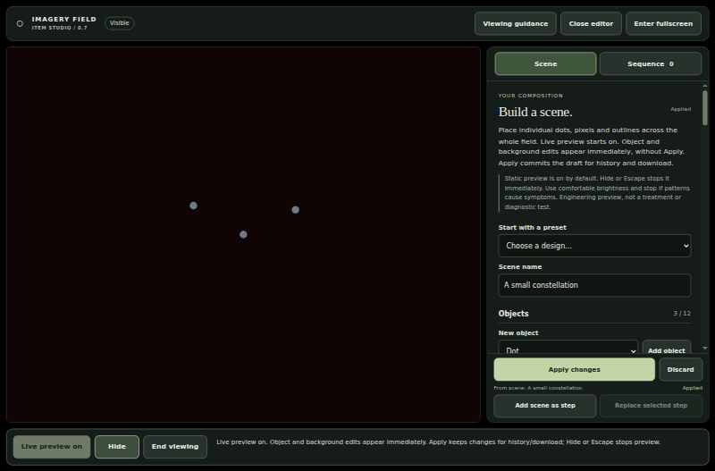

# Imagery Field

Build simple visual scenes in your browser, change their appearance live, and arrange optional item timings or snapshot sequences. The app is a single self-contained HTML file: it works locally without an account, server, Docker, or package installation.

**Engineering preview, not a medical tool.** This is not a treatment, diagnostic test, or validated way to develop mental imagery. Static displays, smooth fades, and software limits do not guarantee sensory safety. Read the [viewing guidance](imagery-app/README.md#before-viewing) before use.

## Get started

1. Download the published [v0.7.0 portable ZIP](https://github.com/woodkill00/aphantasia_build/releases/download/v0.7.0/Imagery-Field-portable.zip) and extract the entire folder.
2. Open **Imagery-Field.html** in a browser with JavaScript enabled. If it opens as text or an attachment preview, choose **Open with** and select a browser.
3. The starter scene appears immediately as a **static live preview**. Change a color or item to see it update without Apply or reloading. **Hide** conceals the field; **Resume live preview** shows it again when you choose.
4. To keep your scene, choose **Apply changes**, then **Download scene JSON**. Confirm the file exists in your Downloads folder.

**There is no autosave.** Apply accepts changes for this session; it does not save a file. Closing or refreshing the page can lose unexported work. Scenes, sequences, and optional notes have separate downloads.

The [v0.7.0 release](https://github.com/woodkill00/aphantasia_build/releases/tag/v0.7.0) is the published engineering preview. It does not contain the unreleased roadmap features below. No installation, account, Node, Git, or server is needed. Keep the included LICENSE with the app. For the development source instead, choose **Code → Download ZIP**, extract it, and open **imagery-app/index.html**. No hosted preview is implied. Physical-device and ordinary file-opening workflows remain unverified; see [compatibility](docs/compatibility.md).

## Current development scope

**Version 0.8 is unreleased. Feature 014 flat session groups are a source-reviewed preparation candidate, not native/visual acceptance.** The development source includes direct selection/dragging, fixed-ratio authored scenes with ten bounded shape families, layers and twelve original editable examples with a text-first, opt-in static-thumbnail gallery, an experimental local PNG/JPEG approximation tool, and an optional session-only journal with separately opt-in display provenance. Research submission stays disabled. These features are **not in the published v0.7.0 ZIP**.

Start with the [0.8 feature guide and limits](docs/roadmap-features.md). Earlier bounded arrangement increments have scoped acceptance. Feature 014 flat session groups now have an independently reviewed touch-placement repair and local DOM/helper evidence, but current native, actual visual, measured performance and clean-checkout package gates remain unrun. Three previous native attempts failed; the diagnostic run confirmed that successful touch placement could reopen the inspector beneath the same touch's compatibility click and activate Delete. The narrow repair and strengthened singleton/group tests require complete fresh evidence. See the [dated candidate report](imagery-app/test-results/TEST-REPORT.md) for exact artifacts and retained failures. Persistence and broader grouping remain deferred.

Historical fourth-increment evidence: [PR 14 run 39423486474](https://github.com/woodkill00/aphantasia_build/actions/runs/39423486474) passed 935 Node checks, all 160 native Chrome groups and the clean-checkout package gate on source `47adabdd1ca0b301ecb96b3a431b76dc1f63ad76`. Independent visual review accepted 26 actual SHA-verified captures: all 22 arrangement frames and four rapid-release/focused-Undo frames. The run emitted 142 captures; this is not a claim that all 142 were manually inspected. Each final head must pass required CI before protected integration; consult [PR 14 checks](https://github.com/woodkill00/aphantasia_build/pull/14/checks) for its outcome. Version 0.8 is unreleased. Earlier failed runs remain recorded, not retroactive passes. The [Spec-Kit roadmap](specs/008-interactive-scene-roadmap/spec.md), [task map](specs/008-interactive-scene-roadmap/tasks.md), and [public work register](project-queue.json) separate implementation, acceptance and deferred work. Old v0.7 results do not verify this source.

## What you can do

- Edit shapes, positions, sizes and colors live. The new-scene background defaults to HSL **4°, 60%, 4%**; background saturation can still reach **100%**.
- In unreleased 0.8, select/drag items or use numeric, tap-place and nudge controls. Keep legacy viewport layout, or explicitly choose **Convert this draft to fixed ratio** / **New fixed-ratio scene** for expanded geometry.
- In unreleased 0.8, generate a bounded editable sketch from a local still PNG/JPEG, or opt into a private journal. Generated shapes can disclose image content; journal downloads can contain private text and, only after separate opt-in, a scene/sequence fingerprint and bounded visible-duration summary. Neither is uploaded.
- Type a precise slider value, drag its slider, or use the fine-step minus/plus buttons.
- Add independently colored outlines and shadows.
- Keep an item **Steady · no pulse**, give it fades, or choose **Pulse**. Mix steady and pulsing items, overlap them, or arrange them one after another.
- Use **Play items once** for a finite item timeline. It stops at the latest item end; timed playback never starts automatically.
- Capture independent scene snapshots and play a separate one-pass **Sequence** with holds and crossfades.
- Import and download local JSON files. No accounts, telemetry, runtime network requests, or intentional browser storage are used.

**Three different previews:** Live preview shows the whole static composition while editing. Item playback uses each item's start/fade/hold settings. Snapshot sequence playback uses captured scenes and its own holds/transitions; it does not run item clocks inside snapshots.

*Historical v0.7 synthetic scene in Linux Chrome, not a mockup or animation. [More interface screenshots and provenance](docs/images/README.md).*

## Find the right guide

- **Use the app:** [Complete user guide](imagery-app/README.md), [examples](examples/README.md), [troubleshooting](docs/troubleshooting.md)
- **Get help:** [Support and privacy](SUPPORT.md), [report a bug](https://github.com/woodkill00/aphantasia_build/issues/new/choose), [security reporting](SECURITY.md)
- **Contribute:** [Contributor guide](CONTRIBUTING.md), [architecture](docs/architecture.md), [test procedure](imagery-app/tests/BROWSER-TEST-PROCEDURE.md)
- **Understand the project:** [What's changed](CHANGELOG.md), [documentation index](docs/README.md), [scientific limitations](docs/scientific-limitations.md), [public work register](project-queue.json)

## Verification and limits

The following is historical evidence for v0.7 only, not acceptance of unreleased 0.8. The merged v0.7 runtime passed **457 code checks, 98 native Chrome groups, and review of 78 rendered captures** in the [final integration run](https://github.com/woodkill00/aphantasia_build/actions/runs/39378606917) on 20 October 2026. This is automated Linux Chrome evidence, including phone-sized touch emulation, not proof of physical-phone, other-browser, full-accessibility, or clinical readiness. The [compatibility record](docs/compatibility.md) explains what was and was not tested; the [test report](imagery-app/test-results/TEST-REPORT.md) preserves exact artifacts and failed attempts.

## License

Repository-authored code, documentation and examples are available under the [MIT License](LICENSE), copyright © 2026 woodkill00. Reuse, modification, redistribution and commercial use are permitted subject to retaining the copyright and license notices; the software is provided without warranty.

Third-party research, linked publications and any separately attributed material retain their own rights and terms. A citation does not relicense its source. The license is not a claim of medical suitability or sensory safety.
