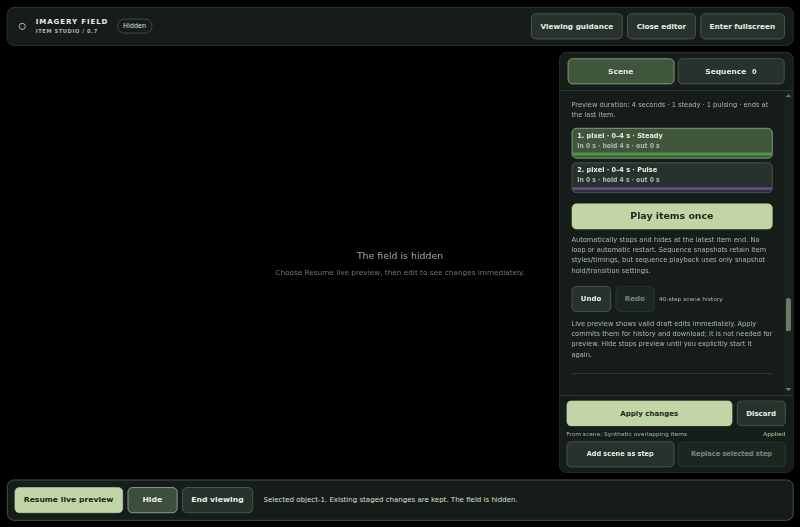
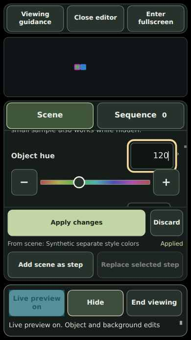

# Static interface screenshots

These are historical v0.7 screenshots, not current v0.8 visual acceptance. They are actual, visually reviewed screenshots of synthetic test scenes in
version 0.7, not generated mockups or a demonstration of personal imagery.
They are still images. Nothing in this page starts playback.

## Live editor

The valid starter composition is visible immediately, but no timer or pulse is
running. Appearance changes update an active Live preview. **Hide** stays in
effect until an explicit reveal action.

## Precision controls

Click the numeric value to type it, drag the slider, or use the fine-step
buttons. **Apply changes** keeps the draft for history and download; it is not
required to see valid edits in an active Live preview.

## Mixed item timing

An item can be steady, pulsing, or faded in and out. The timeline can mix these
choices. **Play items once** is explicit and finite; this screenshot is not
playing an animation.

## Narrow layout

This is Linux Chrome viewport/touch emulation at 320 × 568 CSS pixels, not a
physical phone test. The browser capture harness scales the original captures
for bounded log output. The recorded viewport, device-pixel ratio and scale are
in the [capture manifest](capture-manifest.json).

## Provenance and limits

- Source: [final version 0.7 CI run 39378606917](https://github.com/woodkill00/aphantasia_build/actions/runs/39378606917), captured on 2026-10-20.
- Browser: sandbox-enabled Chrome 155.0.8059.39 on Linux.
- Runtime SHA-256: `c19be4351ce9fbecfeed5f7ed91578e4659ad299cd83e0e3083ea80e2e00c857`.
- Each published JPEG is byte-for-byte identical to its hash-verified source
  capture. The manifest records its byte length, hash and original capture name.
- Captures contain synthetic fixtures only. Raw logs, temporary paths and
  private observations are not included.
- The captures demonstrate those particular rendered states. They do not
  establish physical-device support, accessibility conformance, sensory safety,
  clinical acceptance or efficacy.

Back to the [user guide](../../imagery-app/README.md).
