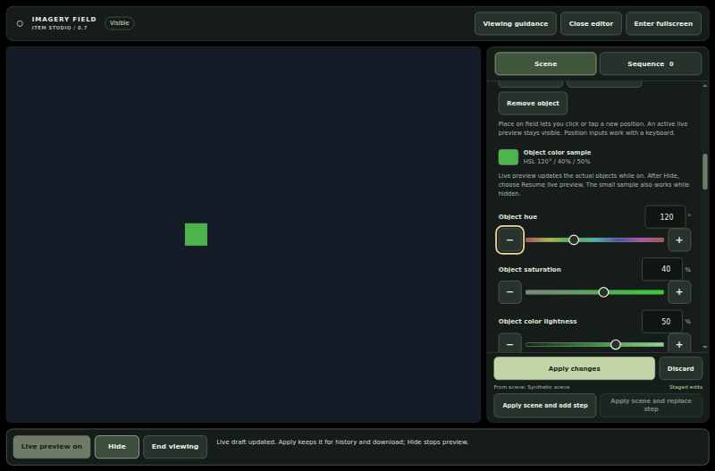

# Imagery Field user guide

Version 0.8 **unreleased development candidate**. The earlier single-item arrangement baseline passed scoped native-browser and arrangement visual checks. At the 20 October 2026 preparation snapshot for the touch-placement source repair, Feature 014 session groups have source/model/DOM evidence; their current native, actual visual, measured performance and clean-checkout CI package gates are NOT RUN. Three earlier native runs failed, including a confirmed touch compatibility-click Delete after valid placement. The source repair and singleton/group regression strengthening are independently reviewed, not browser acceptance. Each final head must pass required CI before protected integration. [PR 14 checks](https://github.com/woodkill00/aphantasia_build/pull/14/checks) document the earlier baseline only; consult the [current candidate evidence](test-results/TEST-REPORT.md) for the changed increment. The published v0.7.0 ZIP does not include its new features. This is the canonical guide to opening the app, editing scenes, using optional timing, and keeping your files. It is not a treatment, diagnostic test, or validated way to develop mental imagery. Static displays, fades, and engineering limits do not guarantee safety.

The separate [editor-aids candidate](#editor-aids-candidate) adds optional visible references. Its recorded runtime passed scoped native-browser, inspected-visual and bounded timing checks; every final head still requires full CI before protected integration. See [PR 15 checks](https://github.com/woodkill00/aphantasia_build/pull/15/checks) and the [exact evidence](test-results/TEST-REPORT.md).

**No autosave:** Apply accepts a scene for this session; only a successful download keeps a file. Closing or refreshing may lose unexported scenes, sequences, notes and journal records.

## In this guide

- [Before viewing](#before-viewing) and [open the app](#open-the-app)
- [First scene and download](#first-scene-and-download)
- [Build a static scene](#build-a-static-scene), [direct preview editing](#direct-preview-editing), and [editor aids candidate](#editor-aids-candidate)
- [Arrange multiple selected items](#arrange-multiple-selected-items-feature-013-candidate) and [flat session groups](#flat-session-groups-feature-014-candidate)
- [Fixed-ratio scenes and examples](#fixed-ratio-scenes-and-examples)
- [Approximate a local picture](#approximate-a-local-picture)
- [Private session journal](#private-session-journal)
- [Style an item and schedule its appearance](#style-an-item-and-schedule-its-appearance)
- [Capture and edit a sequence](#capture-and-edit-a-sequence)
- [Manual preview and one-pass playback](#manual-preview-and-one-pass-playback)
- [Show, hide, and fullscreen](#show-hide-and-fullscreen)
- [Keep your work](#keep-your-work) and [privacy](#optional-observations-and-privacy)
- [Glossary](#glossary), [testing and limits](#testing-and-limits), [troubleshooting](../docs/troubleshooting.md)

## Before viewing

Use ordinary, comfortable room lighting and screen brightness. Do not increase brightness or keep staring to make an image persist. This prototype provides no afterimage-induction regimen or medically safe viewing duration.

If you have photosensitive epilepsy or visual patterns trigger seizures, migraine, or other symptoms, seek your clinician's advice before using it. Stop if you experience headache, dizziness, nausea, eye pain, or a visual disturbance. Seek medical advice for new, persistent, or recurring visual symptoms. Sudden vision loss or severe eye pain needs urgent medical care.

## Open the app

1. Download and extract the repository ZIP, then open its `imagery-app` folder.
2. Open **index.html** in a browser with JavaScript enabled. If it opens as text or an attachment preview, use your computer's **Open with** option to choose a browser.
3. The starter scene is visible immediately as a static **Live preview**, with no timer, fade or pulse. Use **Hide** whenever you want a blank field. Read **Viewing guidance** before timed playback or further viewing.

For in-app help, choose **Viewing guidance**. At compact widths the version branding may be hidden, so retain the README and source version you downloaded. A version label alone does not establish which source passed testing.

No installation, Docker, terminal, account, or local server is required. The HTML is self-contained and designed to work offline. Do not disable browser security or bypass a security warning to open it.

The layout adapts to narrow windows, but physical-device compatibility is unverified. Mobile file viewers may preview HTML without running JavaScript; file opening/downloads vary by device. If your phone cannot open a functioning browser version, use a laptop. Phone-sized emulation is not proof of phone support.

## First scene and download

1. In **Scene**, keep the starter or choose a preset. Change the background saturation from its default 60% to another value. The visible scene changes immediately; 100% is available.
2. Select an object, click its numeric value to type a precise change, then try a minus/plus button. You do not need Apply for a live edit.
3. Choose **Apply changes** to accept your draft. The field hides by design. Choose **Download scene JSON**, then check the downloaded file exists.
4. To continue editing visibly, choose **Resume live preview**. To reload a saved file later, use **Open scene JSON**; imports stay hidden until you explicitly show them.

For ready-made synthetic starting points, see the [examples guide](../examples/README.md). Import a scene with **Open scene JSON**, or a sequence with **Open sequence JSON**. These files demonstrate authoring, not recommended viewing durations.

### Choose the right preview

- **Live preview:** all items are visible as one static composition. It ignores item timing so you can edit appearance.
- **Play items once:** each item's Start, Fade in, Hold, Fade out and optional Pulse determine its finite appearance. It ends at the latest item end.
- **Sequence → Play once:** independent snapshots use sequence holds and outgoing crossfades. Item timing is retained in their data but does not play inside the snapshots.

Only the static live preview starts automatically. Timed playback always needs your explicit action.

## Build a static scene

Use **Scene** to open the scene controls. Your current valid draft is already visible at startup. After you hide it or a handled interruption conceals it, choose **Resume live preview** to show it again. There is no Apply requirement for viewing it. The same scene canvas is arranged beside the desktop inspector or above the portrait inspector, so edits remain visible while you use controls.

1. Choose a preset, or select **New object** and **Add object**. Keep up to 12 items. Legacy viewport scenes offer dots, pixels and circle/square/triangle outlines; explicitly created or converted [fixed-ratio scenes](#fixed-ratio-scenes-and-examples) offer expanded geometry. New objects start at the center.
2. Choose **Selected object**, then change its shape, size, position, or hue/saturation/color-lightness sliders. **Remove object** deletes it from the draft; removing all objects leaves a valid background-only static scene.
3. Type **Horizontal position** and **Vertical position**, or choose **Place on field**. Placement closes the editor; click/tap the field once to stage a position and reopen the editor. An active live preview remains visible. **Esc**, **Hide**, or **End viewing** cancels placement. Numeric inputs, nudge controls and [direct selection/dragging](#direct-preview-editing) provide other movement routes.
4. New presets start with background HSL **4°, 60%, 4%**; background saturation still ranges from **0–100%**, and imported files retain their own background. Adjust the **Background field** sliders. Click/tap the numeric value to type a precise number, or use the adjacent minus/plus buttons for one fine step. The number, slider and buttons stay synchronized. Object/background color samples and slider tracks update immediately from draft values. During Live preview, the actual scene also updates immediately on each valid input, before releasing a slider. While hidden, only the samples update. These are external color previews, not measurements of internal vision. **Color lightness does not change screen brightness.** At 0% lightness the background is black; at 0% saturation hue has no visible effect.
5. Choose **Apply changes** to accept the scene for history/download, or **Discard** to abandon its draft. Neither is needed while previewing. These actions hide the field; choose **Resume live preview** when wanted. Invalid input stops and hides preview; correcting it does not restart it. **Undo**/**Redo** restores applied scenes within the 40-step session history. Scene history does not undo sequence edits.

Positions range from 0–100% with up to two decimal places, but the entire object must fit inside the validated edge inset. In legacy viewport scenes, Size is a whole-number percentage of the field's shorter side: 1–8 for dots/pixels and 1–28 for outlines. Dots are filled circles; pixels are filled squares. Switching an outline to a dot/pixel caps its size at 8. Object hue is 0–359°, saturation 0–70%, and lightness 10–70%; background hue is 0–359°, saturation 0–100%, and lightness 0–40%. These are engineering restrictions, not medically safe settings.

*Static screenshot from the verified v0.7 Chrome run. [Timeline and narrow-layout screenshots with limits](../docs/images/README.md).*

## Style an item and schedule its appearance

The item inspector separates Appearance and Timing. Enable **Outline** and/or **Shadow**, then set each effect's own color. Outline width, shadow offset and blur are percentages of the field's shorter side. Effects may be clipped at the field edge; enabling an effect never silently moves an item. Both effects fade with their item.

**Duplicate object** makes an exact appearance/timing copy with a new identifier. It initially overlaps the original. Use geometry or timing controls to separate them. **Start after previous item** copies the previous item's end into this item's start once; it does not create a continuing link between items.

For each item, set **Start**, **Fade in**, **Hold**, and **Fade out**, in seconds. Hold excludes the fades. The item's end is their sum; the preview's end is the latest end among all items. Two items can overlap or start together. Select an item through its timeline track or the object selector, then use the same numeric controls to edit it.

**Live preview** shows the complete static composition for appearance editing, ignoring the timing schedule. **Play items once** explicitly previews the validated draft's schedule without requiring Apply or committing history. From an already active static Live preview, that one action switches directly to timed item playback; it does not ask you to hide and click again. After an explicit Hide or interruption, the normal reveal guard still applies, with no delayed start queued. Pause freezes the painted frame; Resume continues explicitly. Stop/Hide and natural completion conceal the entire field, including the background. There is no automatic replay. Any edit during timed playback stops and hides it; editing does not restart the timer.

Choose **Steady · no pulse** for an item that holds its base opacity between its fade-in and fade-out. Set both fades to zero when you want it simply present for its Hold time. This is the default. Choose **Pulse** to smoothly vary the entire item's opacity within its active interval. A composition may contain steady and pulsing items together; each retains its own start, hold and fades. The scene has one shared 2–60-second cycle (default 4 seconds); each item chooses its minimum opacity from 50–100% (default 80%). All pulsing items share the timeline clock. Pulse does not extend duration or independently animate shadows/outlines. These are supported engineering choices, not medically safe settings. Combined output still needs assessment; a warning or smooth motion is not clearance.

Timed item previews remain windowed with reachable controls. Reduced-motion preference leaves static editing available and disables timed playback; it does not substitute rapid cuts. Hide, invalid fields, imports, fullscreen changes and handled lifecycle interruptions stop playback with no automatic restart. See the [full item contract](../docs/item-timeline.md) for exact bounds, migration and verification gates.

## Capture and edit a sequence

The editor uses compact **Scene**/**Sequence** sections, one selected-step inspector, and Apply/capture controls outside the scrolling editor content. The historical v0.7 responsive layout passed scoped native focus/raster checks and actual-frame review. The 0.8 arrangement controls passed exact-source native checks and scoped actual-frame review; broader feature visuals are recorded separately. Neither result substitutes for physical-device or actual OS-zoom acceptance.

- **Add scene as step** appends an independent copy of the scene. With a scene draft, its label becomes **Apply scene and add step**; it applies and captures a valid draft in one action, with no separate Apply click. The scene and proposed sequence are both checked before either is accepted. A rejected capture retains both accepted documents and scene history, and the field stays hidden.
- The first captured step sets the shared background and format. Later captures must use the same background and either all legacy viewport scenes or all authored fixed-ratio scenes. Authored snapshots must also share the same canvas ratio. Mismatches are rejected atomically, without silently converting or cropping either document. A background-only scene cannot become a step. Later scene edits never silently change snapshots.
- In **Sequence**, use **Selected snapshot** to select a step. **Replace selected step** explicitly replaces that snapshot using the same atomic apply/capture process; its label becomes **Apply scene and replace step** when there are scene edits. **Load step into scene editor** makes a copy for scene editing; first resolve any existing scene draft.
- Edit **Sequence name**, **Step name**, **Hold · seconds**, or **Transition · seconds**. Valid sequence changes commit immediately while stopped/hidden. There is no Apply sequence button. Invalid raw fields preserve accepted data, show an error, and block playback, sequence export, capture, and structural changes until corrected or discarded with **Discard invalid sequence fields**.
- **Move earlier**, **Move later**, and **Delete step** change the list. Deleting the last remaining step leaves an empty editor that cannot be played or exported. The new final step's transition becomes zero; a former final step moved earlier receives the default 1-second transition. Other transition values are retained. Adjustments are announced and the whole candidate must validate before acceptance.

A portable sequence has 1–32 nonempty snapshots of 1–12 objects. Each hold is 1–600 seconds and each nonfinal transition is 0–60 seconds, both in 0.5-second increments. The final transition is exactly zero. The total of holds plus outgoing transitions must be at most 3,600 seconds (one hour). A zero transition is a direct cut without an inserted blank frame. A crossfade can temporarily combine two 12-object snapshots. These are supported product-capacity bounds, not medical thresholds or suggested durations.

### Try the authoring example

**Load 11-second example** replaces the sequence with circle → square → triangle and leaves the field hidden. It never starts playback. The example is:

- 0–3 seconds: circle hold
- 3–4 seconds: circle → square crossfade
- 4–7 seconds: square hold
- 7–8 seconds: square → triangle crossfade
- 8–11 seconds: triangle hold, then hidden

The example uses editable 3-second holds and 1-second outgoing fades. It is an authoring demonstration, not an exposure prescription.

## Manual preview and one-pass playback

In **Sequence**, **Previous** and **Next** select a step while hiding the field. Choose **Show step** explicitly to display it. Selection never starts a timer or reveals the new step automatically.

**Play once** requires a valid sequence and resolved scene/sequence drafts. It starts at the beginning in the ordinary window. Snapshot playback shows each captured item at static full opacity, ignoring its per-item schedule and pulse. The captured timing metadata is retained for loading that step back into the scene editor. The shared background stays fixed through all holds and adjacent crossfades. There is no automatic replay, loop, strobe, pulse oscillator, contrast inversion, or intensity escalation.

**Pause** freezes the exact last frame actually painted, including an in-between blend. It leaves that frame visible and does not resample the blend at click time. **Resume** explicitly continues from that painted position without catching up for paused time. **Stop / Hide** immediately conceals the scene and resets playback. Natural completion also hides the field, resets elapsed time, and never replays.

Edits, imports, selection/mode changes, fullscreen changes, resize, loss of focus, tab hiding, suspension, page restoration, and handled page lifecycle events stop and conceal. Old callbacks cannot resume playback. To start again, choose an explicit display action. With the browser/OS reduced-motion preference enabled, use **Previous**/**Next** and **Show step**; timed playback is unavailable. A preference change stops current playback and does not resume it.

## Show, hide, and fullscreen

- Startup Live preview is static, not timed autoplay. **Hide** remains in effect through subsequent edits; correcting invalid input, opening the editor or returning to the page never resumes it. Choose **Resume live preview** when you want it back.
- **Close editor** gives more room to a static scene or manual preview. Opening/closing the editor retains an active live draft and restores its unobscured/full-window layout; other modes conceal. **Hide**, **Stop / Hide**, **End viewing**, and **Esc**, when applicable, conceal both objects and the chosen background.
- **Enter fullscreen** is optional for a static scene or manual step preview. Timed Play/Resume is windowed-only so Pause and Stop stay reachable. Entering or leaving fullscreen cancels playback and hides the field.
- Fullscreen hides normal editor/navigation chrome. While hidden it offers **Live preview** or **Show selected step**, according to the selected section. While showing, a small upper-right **Exit** control remains available for touch and keyboard; it hides the field before exiting. Escape also leaves browser fullscreen. Failure keeps the field hidden with recovery instructions; the ordinary window remains usable.
- Explicit reveal uses the existing temporary anti-repeat guard. If blocked, the field stays hidden; choose Show or Play again later. No reveal is queued. The guard is an engineering restriction, not a medically safe interval or suggested schedule.

The only pulse in this version is the finite shared-clock opacity effect described above. Unrestricted flash/strobe, independent-frequency modulation and offscreen flash-risk analysis are not implemented; warnings do not establish sensory safety.

## Keep your work

Use the matching controls for each document:

- **Download scene JSON** / **Open scene JSON**: legacy viewport scenes remain version 3. Explicit fixed-ratio scenes use version 4 and also retain their canvas ratio and shape geometry. Both include background, shared pulse period, effects and per-item timing. Valid version 1/2 files migrate to version 3 only after original validation; they are never silently converted to fixed ratio. Version 1 palette approximation remains documented.
- **Download sequence JSON** / **Open sequence JSON**: legacy viewport sequences use version 2; fixed-ratio sequences use version 3, with a shared canvas contract repeated and checked in every snapshot. Both retain background, styled snapshots, names, snapshot holds/crossfades and item-pulse periods. Valid version 1 sequences migrate to version 2. No sequence includes notes, journal records, playback state, loop settings, URLs or executable expressions. Static files and sequence files are distinct formats, even where version numbers coincide.
- Optional note files and optional journal files use separate preview/selection/download processes below. They are export-only. Original image bytes, filename and metadata are not included in scene/sequence exports; derived shapes may still disclose image content.

Current scene-v3/v4 and sequence-v2/v3 files support background saturation up to 100%. Legacy scene-v2/sequence-v1 inputs still must satisfy their original 60% maximum before migration; invalid legacy values are rejected rather than clamped. The published v0.7 app cannot open scene-v4 or sequence-v3. Earlier app versions may also reject backgrounds above their former 60% saturation maximum. Keep the original file when trying a newer format; no downgrade export is offered.

Scene and sequence inputs are bounded to 1 MiB of UTF-8 JSON and validated before acceptance. Successful imports leave the field stopped/hidden. Invalid, canceled, or superseded reads preserve accepted data. Resolve invalid fields before exporting. Check your browser's Downloads to confirm a file was kept; the app can request a download but cannot confirm it reached disk. Saving a file does not modify the HTML.

There is no durable autosave or browser storage. Closing/refreshing can lose unexported scenes, sequences, notes, journal records and retained image work. Keep the page open if a download fails. **Use editable draft**, **Apply changes** and **Download scene JSON** are three different actions; only a successful download keeps a file.

## Optional observations and privacy

Notes are independent of scene and sequence files and scene history. Choose a category, enter your note, and select **Preview note export**. Review the exact preview, check **Include this note in the download**, then choose **Download note JSON**. If category or text changes, preview and select it again. Notes allow up to 4,000 characters and are exported separately.

Keep observations of a visible scene, incidental aftereffects, and attempts to imagine an absent object distinct; “none” and “unsure” are valid. Notes produce no diagnosis, score, or improvement claim.

Avoid unnecessary identifying/medical details. The note export contains its format/version, category, and text. Scene, sequence, and step names may also contain personal text; inspect every file before sharing. The app has no accounts, telemetry, backend, or runtime network dependency. Browser session restoration, extensions, device backups, and cloud-folder syncing may retain or copy content/downloads. End viewing and closing the page are not secure deletion.

## Glossary

- **Item / object:** one shape in a scene. Some controls say “object”; timing and styling also call it an “item.”
- **Draft:** edits currently being made. Live preview can show them before Apply.
- **Applied scene:** the accepted scene available to session history and scene download. Apply is not disk saving.
- **Snapshot / step:** an independent captured copy of a nonempty scene in a sequence. Later scene edits do not change it.
- **Hold:** time at the item's steady/pulsing phase, or time a snapshot stays before its outgoing transition. Item fades are additional time.
- **Fade / transition:** an item's opacity change, or a crossfade between adjacent snapshots. Zero means no fade or a direct cut.
- **Pulse:** optional smooth opacity variation on an item during finite item playback, not a replay loop.
- **JSON:** a text data file used to reopen a scene or sequence. It is not an image or video; note JSON is separate and cannot be imported.

## Testing and limits

[PR 14 run 39423486474](https://github.com/woodkill00/aphantasia_build/actions/runs/39423486474) passed 935 Node checks, all 160 native Chrome groups and the clean-checkout package gate on source `47adabdd1ca0b301ecb96b3a431b76dc1f63ad76`. Independent visual review accepted 26 actual SHA-verified captures: all 22 arrangement frames and four rapid-release/focused-Undo frames. The run emitted 142 captures; this is not a claim that all 142 were manually inspected. Each final head must pass required CI before protected integration. [PR 14 checks](https://github.com/woodkill00/aphantasia_build/pull/14/checks) document the earlier baseline only; consult the [current candidate evidence](test-results/TEST-REPORT.md) for the changed increment. Version 0.8 is unreleased. Native Chrome and the inspected frames do not establish accessibility conformance or empirical usefulness. See the [feature evidence boundaries](../docs/roadmap-features.md#verification-and-deferred-work) and current [public work register](../project-queue.json).

For historical context only, the merged version 0.7 runtime passed 457 non-browser checks, 98 native Chrome groups, and independent inspection of 78 rendered captures in the [final integration run](https://github.com/woodkill00/aphantasia_build/actions/runs/39378606917), dated 20 October 2026. The [compatibility record](../docs/compatibility.md) identifies the exact tested runtime and remaining gaps. The [test report](test-results/TEST-REPORT.md) retains earlier attempts and failures; a later documentation or packaging change does not inherit verification merely by retaining this version label.

Physical phones, Safari/Firefox, ordinary OS file-opening/chooser workflows, actual OS/browser zoom, screen-reader workflows, and full accessibility remain unverified. The 640×450 scenario is effective viewport reflow, not actual zoom. Software checks and screenshot review provide no clinical clearance or evidence of safety or effectiveness.

Need help? Read [troubleshooting](../docs/troubleshooting.md) or [support](../SUPPORT.md). Use synthetic reproductions in public reports, never private notes or medical observations.

## Direct preview editing

During static **Live preview**, click or tap a visible item to select the topmost eligible item and open its inspector. Movement begins after a 4 CSS-pixel drag threshold; the grab offset is retained, and coordinates and live pixels update together. Release completes one draft move. Escape, Hide, viewport changes or interrupted pointer capture cancel the move and hide the preview. Timed playback is not a direct-editing surface.

Shadows are not selection targets. Hollow shapes are selectable through their interior, with a small hit tolerance for thin/tiny items. Background clicks and fixed-ratio letterbox bars do not move an item. Use **Selected object** or **Select next overlapping item** when overlaps make pointer selection ambiguous.

Use the four nudge buttons or focus the preview and use arrow keys (1 position unit, Shift for 0.1). Text fields retain ordinary arrow-key behavior. Typed coordinates and **Place on field** remain available without dragging. **Undo move** and **Redo move** affect only the draft, conceal the preview and are separate from applied scene history; they retain up to 40 moves. Other edits reset move history. **Apply changes** is still required before ordinary scene download; moving a preview does not silently save or apply it.

**Move back one layer** / **Move forward one layer** change the selected item's draw order by one position. Later items draw over earlier ones. **Duplicate object** makes an overlapping editable copy with a fresh ID.

### Session locks and arrangement

The fourth development increment implements the following controls, accepted within the recorded native Chrome and scoped arrangement visual review. It is not in the published v0.7.0 download; each final head must pass required CI before protected integration.

- **Lock selected item** protects that item's stored shape, position, appearance and own timing for this page session. It does not freeze the whole picture: background, canvas ratio, shared pulse period and other items can still change. Locked items stay selectable and are identified in text. Duplicate may create a new unlocked copy without changing the locked source.
- **Unlock all items** remains available. Applied-scene **Undo/Redo** are unavailable while any lock exists, with an explanation beside those controls. Apply and Add/Replace snapshot capture keep locks. **Undo move/Redo move** and Discard are allowed only when they preserve every locked record; otherwise unlock first.
- Successfully replacing the scene clears locks and announces this. That includes New/Convert, either preset selector, gallery Use, scene import, Load step into scene editor, image Use and Undo image draft replacement. Failed, canceled or stale replacements keep the prior scene and locks. Opening a sequence alone keeps editor locks; successfully loading a step clears them.
- **Snap: Off / 1 / 5 / 10** affects drag and tap-placement only, in normalized content units. It starts Off and does not move existing items when changed. Letterbox margins are not placement targets. Typed positions, directional buttons, focused-preview arrow keys and centering remain exact and unsnapped.
- **Center horizontally**, **Center vertically** and **Center both axes** set the selected unlocked item's X, Y or both to 50. Each actual change is one draft move, not Apply; an unchanged position adds no history. A hidden preview stays hidden.

Lock, unlock or snap changes cancel an active move/placement rather than completing it. Locks never block Hide, Stop, End, Escape or ordinary downloads. Locks and snap settings are session-only and are not saved in scene/sequence files. Those accepted fourth-increment controls did not include visible aids; the separate candidate below adds only an optional editor grid and center guides. Later candidate sections below describe multi-selection/equal gaps and flat session groups; the earlier fourth-increment evidence does not accept them. See the [contract and acceptance map](../specs/008-interactive-scene-roadmap/tasks.md#if-050-fourth-increment-acceptance-matrix).

### Editor aids candidate

**Unreleased candidate: recorded scoped native-browser, visual and bounded timing checks passed; every final head requires full CI before protected integration.** These controls are not part of the published v0.7.0 ZIP or covered by the earlier core pass. See the [bounded specification](../specs/012-editor-aids/spec.md) and [acceptance tasks](../specs/012-editor-aids/tasks.md).

- In **Scene → Editor aids**, check **Show editor aids** only while a valid static Live preview is visible and the editor is open. It starts unchecked. Choose **Grid spacing · content units**: 1, 5 or 10, with 5 initially. **Center guides**, initially unchecked, adds references halfway across and down the authored content area. Black letterbox margins stay unmarked.
- The visible grid and **Snap centers** are independent. A grid does not enable snap; snap does not show a grid. Neither changes existing item coordinates. Snap still affects only drag/tap placement; typed positions, nudges and centering retain their existing behavior.
- In a small preview, only a subset of grid lines is painted so grid lines stay at least 8 CSS pixels apart. The status reports the actual horizontal/vertical intervals. This changes the visible reference, not snap precision, and is a legibility choice rather than a safety threshold.
- Hide/End/Escape, invalid input, imports, fullscreen/lifecycle interruption, closing the editor or leaving static Live turns aids off. A successful scene replacement also turns them off without changing that action's existing Live/hidden behavior. Resume Live shows only the scene; check **Show editor aids** again if wanted. Settings may be adjusted while hidden without revealing anything. Aids are absent from fullscreen and item/sequence viewing, including paused playback.
- Aids and preferences are session-only editor information. They are not painted into the scene, saved in scene/sequence downloads, or included in captured steps. Closing/reloading loses the preferences. They do not move shapes, apply a scene or start playback.
- If optional display provenance is enabled, showing aids makes the current viewing action's scene fingerprint/duration association **unavailable**, because the screen now includes editor marks. Unchecking aids alone does not restore it. A successful fresh explicit clean Live/Show or new one-pass playback can begin a new eligible interval; failed Show attempts, tracking toggles and Pause/Resume cannot. Existing saved reflections stay unchanged. You can still record a reflection with unavailable fields; there is no need to repeat a view.

## Fixed-ratio scenes and examples

The startup scene and imported legacy scenes remain viewport-relative. Their layout is not silently reinterpreted.

- **Convert this draft to fixed ratio** retains the draft's items and creates a square authored draft. The layout can change, so inspect it before Apply.
- **New fixed-ratio scene** replaces the staged composition with a fresh single-point square starting scene. Keep important work in a downloaded file first.
- Then choose **Authored aspect ratio**: 1:1, 4:3, 3:4, 16:9 or 9:16. The complete canvas fits inside the preview with black margins, not cropping or stretching. Margins are not scene content or placement targets.

Fixed-ratio scene-v4 supports dot, pixel, circle, square, triangle, ellipse, rectangle, rounded rectangle, polygon and star. **Size** controls width and **Height** controls height, as percentages of the authored canvas's shorter side. Circle/square/dot/pixel keep equal dimensions. Width/height are 1–28 whole units, or 1–8 for dots/pixels. Rotation is 0–359 whole degrees. **Body** chooses outline or filled; dots/pixels stay filled. Polygons offer 3–32 sides, stars 3–16 points and inner ratio 0.20–0.80, and rounded rectangles corner ratio 0–0.50. Whole shapes and conservative effect bounds must fit the validated inset; reduce geometry/effects or move inward if validation fails.

**Original preset gallery** offers twelve original editable compositions: Balanced contours, Sparse symmetric points, Sequential shapes, Mixed steady and pulse, Spatial triplet, Symmetric pair, Displaced pair, Overlapping contours, Simple house, Simple tree, Simple boat, and Small still life. Filter the text list by item/color count, vertical symmetry, overlap or authored timing; open an entry for its description, revision, MIT provenance and validator result. Color count covers item colors, not the background. These filters are descriptive, not recommendations or ranked treatments.

Thumbnails begin hidden. **Show static thumbnails** explicitly displays small 64×48 previews; every item stays static even in a timed example. **Hide static thumbnails**, the main Hide/End controls, Escape, filter changes and page interruptions conceal them. Nothing restores them automatically. **Use draft** replaces the staged composition while hidden, without Apply, download or playback. Resume Live preview only when wanted, and Apply/download separately to keep it. Sequential shapes and Mixed steady and pulse run their authored timing only after **Play items once**. Editable exports omit catalog identity, so editing never falsely preserves an unchanged stimulus ID.

A fixed ratio helps preserve composition, not physical size, viewing distance, luminance or sensory safety. See the [data contract](../docs/architecture.md#authored-scene-v4-and-sequence-v3-contract).

## Approximate a local picture

This is an **experimental bounded shape sketch**, not photo reconstruction, semantic recognition or an imagery assessment. Its pixel-error summary is not evidence of useful correction effort, natural-image quality or efficacy.

1. Keep important scene work first. Choose **Open local image tools**, then a still PNG or JPEG: at most 8 MiB encoded, 4096 pixels on either side and 8,388,608 decoded pixels total. Animated PNG, GIF, SVG and other formats are not supported; malformed or over-budget input is rejected.
2. The image is checked before decoding, checked again after orientation-aware decode, and reduced to a retained thumbnail of at most 128 pixels per side. The source remains hidden. **Show source thumbnail** displays it only when requested and discards any candidate; Generate hides it again.
3. Set a maximum of 3, 6 or 12 items, a reproducible seed, canvas ratio, source-bounded or muted palette, and numeric crop/focus percentages. The crop is contained inside the canvas without stretching; unused space keeps the dark background.
4. Choose **Generate candidate** explicitly. Progress reflects a bounded search, not remaining wall-clock time. It yields between small work slices and can be cancelled. Review its textual shape list and pixel-error summary. The prior scene is unchanged by generation.
5. **Use editable draft** stages ordinary scene-v4 shapes, still hidden; it does not Apply, download, or start timing. Explicitly resume Live preview to inspect and edit the result. Before another scene edit, **Undo image draft replacement** restores the previous valid draft and selection, still hidden; it is separate from move undo and applied-scene history. Use is rejected if the existing scene fields are invalid. Choose **Apply changes**, then **Download scene JSON**, to keep the new result. **Discard** returns to the accepted scene, not a backup of every earlier staged edit.

**Cancel / discard candidate** leaves scene work unchanged; **Clear source** also removes the retained thumbnail and resets conversion options. Hide, End, import, a new edit or a page interruption invalidates pending candidates. A stale completion cannot reveal or apply anything. File read/decode itself cannot be forcibly aborted; another intake waits until the outstanding decode has settled and released its resource.

No image upload, remote URL input, cloud model, storage or original-image export is used. Filename and metadata do not enter scene exports. **Derived shapes may still disclose image content** and are not anonymous. Browser decoder memory is implementation-dependent; the app's limits are engineering caps, not a universal memory/performance promise. See the [resource ledger](../docs/architecture.md#local-image-resource-and-cancellation-contract).

## Private session journal

Open **Private session journal** and optionally check **Enable optional session reflections**. It is off initially and the editor works without it. Nothing is recorded until **Add reflection to session**. Every answer defaults to **Skipped**; None, Uncertain and Not asked remain distinct choices where offered. Do not repeat a display to answer.

The separate fields describe external perception, visual persistence, voluntary imagery, nonvisual memory, comfort before/after, discomfort, early stopping, preference and ease of use. They are custom exploratory descriptions, not a validated questionnaire, diagnosis, causal finding, score or evidence of imagery improvement. Scene identity and visible-duration fields are **unavailable by default**.

A second unchecked option, **Include optional scene fingerprint and visible duration in future reflections**, tracks only subsequent successful main-field displays. It does not reconstruct earlier viewing or track gallery/source thumbnails. When the latest display has ended and its digest is ready, a new reflection can include a SHA-256 canonical scene/sequence fingerprint, format and renderer versions, mode, planned duration, foreground-visible duration and stop reason. Timed playback fingerprints the whole sequence; manually showing a step fingerprints that step as a scene. Paused frames remain visible and keep counting. A changed displayed draft starts a new interval, not a cumulative viewing total.

The [editor-aids candidate](#editor-aids-candidate) also excludes aid-marked viewing and does not restore association merely when guides are unchecked.

While a display is active or its digest is pending/failed/unavailable, these fields remain unavailable; an older result is never substituted. The status beside the option explains readiness. Uncheck the option to stop tracking and discard retained provenance. Turning reflections off also disables it. No timestamp/epoch, original picture, full scene content or device identifier is exported. The renderer label `0.8.0-dev.provenance1` is a version identifier, not a hash of the app. A fingerprint does not make a record anonymous, and visible duration is not gaze, attention, light dose or a safety measurement.

Up to 20 reflections are retained in this page, with at most 2,000 characters per optional note. Adding one resets unfinished answers to Skipped and does not select it for export. Turning reflections off discards unfinished answers but keeps added records until deleted or cleared.

To download: select the wanted reflections, choose **Preview selected journal export**, inspect the exact journal-v2 JSON, separately check that you reviewed and approve it, then choose **Download approved journal JSON**. Each download needs a current preview and approval. Edits invalidate the preview. Scene/sequence/note downloads do not include the journal; journal files are not imported.

**Clear session journal** removes this page's records, unfinished answers and retained display provenance, not files already downloaded. If tracking remains checked, only a later display can create another summary. There is no autosave or browser storage; close/refresh can lose every unexported record. Downloads may contain private text and are not anonymous. Page clearing is not guaranteed secure deletion from browser restoration, extensions or backups.

**Research submission is not available.** There is no endpoint, background upload queue or working Send control. Enabling reflection or approving a local download is not research consent. Actual collection remains blocked pending an identified operator, applicable ethics/privacy/security review, instrument rights, a reviewed protocol/statistical plan, retention/withdrawal rules and explicit activation. No participant data, efficacy rankings or statistics are collected by this candidate.

## Arrange multiple selected items (Feature 013 candidate)

The inherited Feature 013 source has independently reviewed repairs after its first native run failed 6 of 200 groups. Those repairs passed 1192 local Node checks at its 20 October 2026, 15:53 UTC preparation snapshot; [PR 16 checks](https://github.com/woodkill00/aphantasia_build/pull/16/checks) record subsequent exact-head outcomes. The changed Feature 014 runtime still requires its own native and visual evidence; [the contract](../specs/013-atomic-selection/spec.md) and [task gates](../specs/013-atomic-selection/tasks.md) describe what must pass before integration.

Use the item checklist to select several items, or Select all/Clear. The Move anchor chooses which selected item drives placement and snapping; it is not a hidden style-edit target. Selecting an item in the preview keeps an already-selected set together, while selecting an unselected item selects its complete unit: one ungrouped item or its whole session group. Shift-click toggles that unit. The ordinary item selector can return to one ungrouped item or one complete group. Selection itself adds no canvas outlines, changes no scene data, and is not saved.

With several items selected, individual style, timing and lock controls are unavailable. Use the labeled arrangement controls or preview arrow keys to move the selection. Exact deltas and keyboard nudges either move the entire selection or reject the whole command. Drag/placement snapping follows the Move anchor and preserves relative spacing. Center selection uses its combined geometric bounds; the existing one-item Center command keeps its established stored-position behavior. Align uses selected bounds; Distribute uses equal edge gaps, not equal center spacing, and rejects an infeasible or overlapping result.

Any selected locked item blocks movement, alignment, distribution, deletion and reordering as a whole. Duplicate is the exception: it creates independent unlocked copies if the twelve-item limit permits every copy. Undo/Redo draft arrangement keeps at most forty complete transactions, separate from accepted-scene history. Newly locked records can block a history target without consuming it. No-op commands add no transaction or erase Redo. Invalid raw fields stay visible for correction; correcting to the unchanged canonical value retains arrangement history, while successfully staging a different ordinary edit clears it.

Arrangement changes remain drafts. Apply accepts them; Download saves accepted data. Hidden commands never start a preview. Cancelled or interrupted gestures roll back the whole provisional movement. Selection, Move anchor, locks and arrangement history are session-only; export contains ordinary scene objects and their layer order, not editor state. The following separately scoped candidate adds flat session groups; no earlier result accepts the changed runtime.

## Flat session groups (Feature 014 candidate)

This source preparation implements the [flat-group contract](../specs/014-session-groups/spec.md), with local source/model/DOM review but no claimed native, actual visual, performance or CI acceptance. Choose two or more ungrouped items, then **Group selected items**. Selecting any member through **Select item or group**, a checkbox, the timeline or the preview selects the whole group. **Move anchor** still chooses an actual selected member for placement and snapping. The summary distinguishes selected items from arrangement units. Group labels are derived, not editable names.

Each complete group counts as one rigid arrangement unit; each selected ungrouped item counts as one. Align requires at least two units and equal gaps at least three. A group uses its combined shape/outline bounds, including internal empty space and excluding shadows. Members move together; an infeasible gap or member constraint rejects the entire command. A lone group centers its combined bounds rather than each member. Grouping does not collect nonadjacent members into a layer block.

**Ungroup selected groups** dissolves selected groups in one operation and leaves their items selected. To edit or lock/unlock one member, Ungroup first and then explicitly select that item. Any selected lock blocks a scene-changing arrangement for the whole selection, while Group/Ungroup and metadata-only history can remain available. Duplicate makes independent unlocked item copies and independent copied groups within the unchanged twelve-item/six-group limits. There is no nesting, group merging, isolation editor or group transform.

Group/Ungroup uses the same forty-total draft arrangement history but changes no scene pixels, dirty state, scene hash, accepted history or exported format merely because metadata changes. Undo/Redo arrangement still conceals the preview. Metadata commands do not bypass invalid raw input, captured-gesture rollback or immediate Hide.

**Groups are only for this editing session. Apply and downloads do not save them. Loading, Discard, accepted-scene history or reload clears them.** Successful Apply and snapshot capture retain groups in this page, but exported scenes and sequences remain flat. Ordinary valid edits and Add preserve existing groups. On successful Discard, if any session group exists anywhere in the draft, clear every group and select the first accepted item, or empty when none exists. With no groups, preserve an existing singleton selection if its ID remains valid in the accepted scene; otherwise choose the first accepted item or empty. Both branches clear draft history, advance generation/revision and retain the existing lock preflight and concealment. Successful whole-scene replacement clears groups even when item IDs or canonical bytes match; rejected, stale or cancelled replacements retain them.
